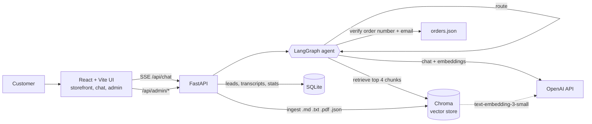

# AI Support Chatbot

An AI customer-support assistant for a fictional clothing store, **Nova Threads**. It answers from the store's own documents (RAG), looks up orders, hands off to a human when unsure, and ships with an admin panel to update its knowledge.


## Demo

> Add your demo GIF here: `docs/demo.gif`


| Storefront + chat | Order status card | Admin dashboard |
| --- | --- | --- |
| _screenshot: `docs/storefront.png`_ | _screenshot: `docs/order-card.png`_ | _screenshot: `docs/admin.png`_ |

## Features

- **RAG answers** grounded only in the store's documents, streamed token by token, with source chips (e.g. "Returns Policy") under each answer.
- **Order lookup tool**: asks for the order number *and* email, verifies both, then shows an order status card (items, timeline, tracking number). Wrong email = no data disclosed.
- **Product questions** (sizes, materials, prices, availability) answered from `products.json`.
- **Fallback and handoff**: when retrieval isn't relevant enough (or the model says it can't answer), the bot offers to connect the customer with the team and shows an inline form. Submissions are saved as leads in SQLite.
- **Conversation memory** within a session, and short, friendly answers that never invent policies.
- **Admin dashboard** (`/admin`, password protected): upload `.md` / `.txt` / `.pdf`, edit documents in the browser, re-index with a progress bar, view leads and full conversation transcripts, plus stat cards. New or edited content is indexed immediately.
- **Cost controls**: capped output tokens, max 4 retrieved chunks, per-session rate limiting, and a cheap default model.
- **Friendly errors** for a missing API key, invalid key, quota/rate limits, timeouts and network failures.

## Architecture



Agent graph: `route → (smalltalk | order | retrieve → answer) → handoff when nothing relevant`. Nodes stream tokens, sources, order cards and the handoff form to the UI as server-sent events.

## Setup

Requirements: Python 3.11+, Node 18+, and an OpenAI API key.

```bash
# 1. Clone
git clone https://github.com/mirabdullahdev/ai-support-chatbot.git
cd ai-support-chatbot

# 2. Configure
cp backend/.env.example backend/.env
# 3. Open backend/.env and set OPENAI_API_KEY=sk-...
```

**4. Run everything with one command**

```bash
# macOS / Linux / Git Bash
./scripts/dev.sh        # or: make dev
```

```powershell
# Windows PowerShell
.\scripts\dev.ps1
```

The script creates a virtualenv, installs dependencies, then starts the backend on <http://localhost:8000> and the frontend on <http://localhost:5173>. On first startup the knowledge base is ingested into Chroma automatically (this needs your API key).

Open <http://localhost:5173> for the storefront and <http://localhost:5173/admin> for the dashboard (default password `admin123`, set `ADMIN_PASSWORD` in `.env`).

### Environment variables

| Variable | Default | Purpose |
| --- | --- | --- |
| `OPENAI_API_KEY` | _(empty)_ | Your OpenAI key. Never commit it; `.env` is gitignored. |
| `OPENAI_MODEL` | `gpt-4o-mini` | Chat model |
| `ADMIN_PASSWORD` | `admin123` | Admin dashboard password |

Optional tuning (all have defaults): `MAX_OUTPUT_TOKENS` (350), `RATE_LIMIT_PER_MINUTE` (12), `RELEVANCE_MAX_DISTANCE` (0.62, the cosine-distance cutoff for the handoff fallback).

## Demo order

Use this mock order to try the order lookup:

| Order number | Email |
| --- | --- |
| **NT-10427** | **mia.johnson@example.com** |

All eight mock orders live in [`backend/data/orders.json`](backend/data/orders.json).

## 60-second demo script

1. **0-5s** Load the storefront and open the chat.
2. **5-20s** Click **"Do you ship internationally?"** and watch the streamed answer and source chip.
3. **20-35s** Click **"Where is my order?"**, send `NT-10427` and `mia.johnson@example.com`, and the order card appears.
4. **35-45s** Ask something not in the docs (e.g. "Do you offer custom tailoring?"), then fill in and submit the handoff form.
5. **45-60s** Open `/admin`, show the lead, upload a new FAQ `.md` (it's indexed instantly), hit **Re-index**, then ask the bot about it.

## Tests

```bash
cd backend
python -m pytest -q
```

The suite covers the order lookup tool, ingestion/chunking/retrieval and the chat endpoint (streaming, order flow, handoff, rate limiting, admin upload). OpenAI is mocked, so no API key or network is needed.

## Project structure

```
backend/
  app/          FastAPI app, LangGraph agent, ingestion, SQLite, OpenAI wrapper
  knowledge/    faq.md, shipping_policy.md, returns_policy.md, products.json
  data/         orders.json (mock orders)
  tests/        pytest suite
frontend/
  src/          React app: storefront, chat widget, admin dashboard
scripts/        dev.sh / dev.ps1 (run backend + frontend together)
```

## License

MIT
